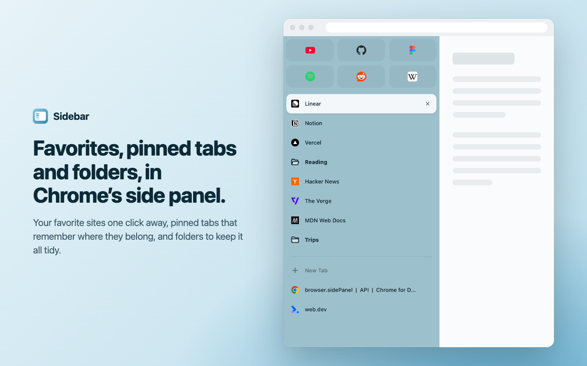

# Sidebar

A Chrome extension that brings an Arc-style sidebar to Chrome's side panel: Favorites, pinned tabs that remember their address, nested folders, a list of open tabs, drag and drop, split view, and a one-step import from the Arc browser. Everything stays on your device.



## Development

Requires Node 24 and pnpm.

```sh
pnpm install
pnpm dev          # opens Chrome with the extension loaded; reloads on change
pnpm build        # builds into .output/chrome-mv3 (load it via chrome://extensions → Load unpacked)
pnpm test         # unit tests (Vitest)
pnpm test:e2e     # builds, then drives the real extension in Chromium (Playwright)
pnpm screenshots  # regenerates the Chrome Web Store images in store/
pnpm zip          # packages the extension for the Chrome Web Store
```

`PLAN.md` describes the design decisions, `PRIVACY.md` is the privacy policy and `store/LISTING.md` holds the store listing text.

Sidebar is an independent project and isn't affiliated with The Browser Company.
